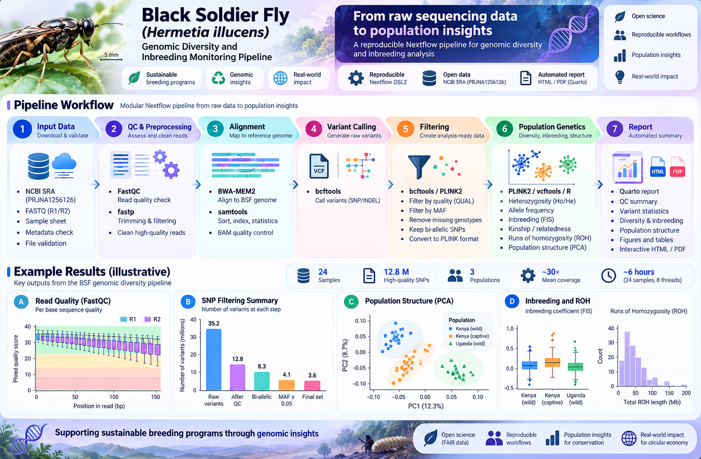

# BSF Genomic Diversity & Inbreeding Monitoring — v4

Full 12-week internship repository scaffold for a reproducible *Hermetia illucens* population-genomics workflow.

## Pipeline overview



*Figure 1. Visual overview of the planned Nextflow workflow from public BSF sequencing reads to QC, variants, population genetics and reporting. **All plotted results and numeric summaries in this infographic are illustrative, not measured results or validated benchmarks.***

[View full-size infographic](docs/images/bsf-pipeline-infographic.png) · [Data and workflow](docs/DATA_AND_WORKFLOW.md) · [CLI run guide](docs/CLI_RUN_GUIDE.md)

## Public resources
- NCBI BioProject **PRJNA1256126 (FLYgene)** — public raw WGS data for BSF genetic-diversity research in Kenya/Uganda.
- RefSeq **GCF_905115235.1** — chromosome-level *H. illucens* reference assembly.

## Pipeline
FASTQ → validation → FastQC → fastp → BWA-MEM2 → BAM QC → bcftools per-sample calls → cohort merge → biallelic SNP filtering → PLINK QC → allele frequencies / heterozygosity / LD-pruned PCA / KING kinship / ROH → MultiQC + Quarto reporting.

## Quick start
```bash
conda env create -f envs/environment.yml
conda activate bsf-popgen
./bin/download_reference.sh

# Inspect PRJNA1256126 metadata and replace assets/samplesheet.csv with selected real runs.
./bin/download_sra_subset.sh SRR_ACCESSION_1 SRR_ACCESSION_2

nextflow run main.nf \
  --input assets/samplesheet.csv \
  --reference reference/reference.fna \
  --outdir results \
  -profile conda
```

## 12-week plan
See `docs/weeks/week01.md` ... `week12.md`.

## Scientific safeguards
The repository intentionally does **not** invent SRA accessions or population labels. Select real runs from current NCBI metadata before downloading. QC thresholds are starting defaults and require justification/sensitivity analysis. Inspect depth before using hard genotype calls; low-depth data may require genotype-likelihood methods.

## GitHub
Large FASTQ/BAM/VCF files are excluded by `.gitignore`. Commit workflow code, configs, small metadata, tests, documentation and report templates—not raw sequencing data.


## Full documentation

- [Documentation index](docs/INDEX.md)
- [Repository and GitHub guide](docs/REPOSITORY_GUIDE.md)
- [CLI run guide](docs/CLI_RUN_GUIDE.md)
- [Data and workflow](docs/DATA_AND_WORKFLOW.md)

**Status:** Development version; full public-data validation pending. Simulated figures are not real results.
