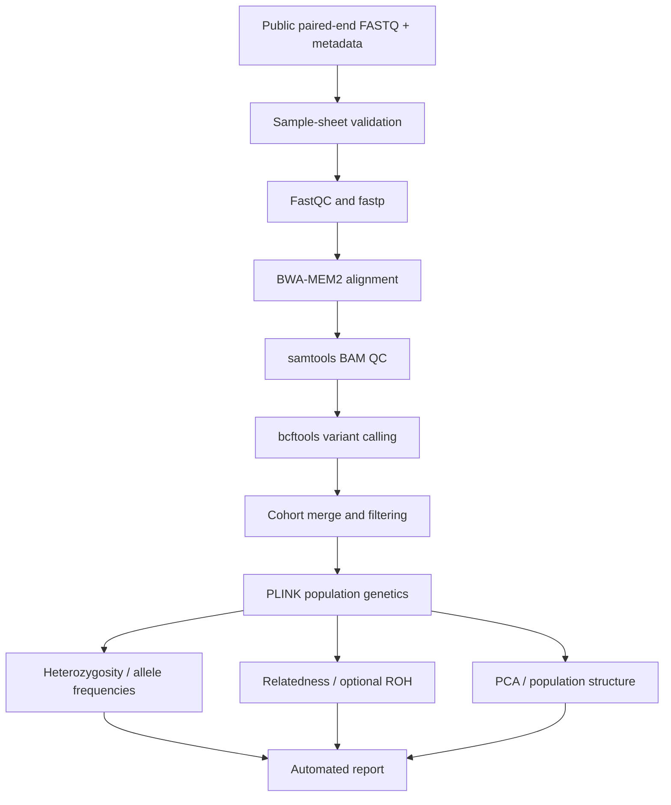

# BSF Genomic Diversity Pipeline v4 — CLI Run Guide

> **Status:** Development pipeline. The commands below describe how to attempt a run; a successful end-to-end run on real BSF data has **not** been verified. Replace all example accession IDs and paths with real inputs.

## 1. Workflow overview



## 2. Prerequisites

- macOS or Linux shell; a Linux environment is recommended for tool compatibility.
- Java and Nextflow DSL2, Conda or Mamba.
- For public data download: `curl`, `samtools`, and NCBI SRA Toolkit (`prefetch`, `fasterq-dump`).
- Adequate storage and RAM for the selected sequencing data.

Check installation:

```bash
java -version
nextflow -version
conda --version
command -v prefetch
command -v fasterq-dump
```

## 3. Extract the repository

```bash
unzip bsf-genomic-diversity-pipeline-v4.zip
cd bsf-genomic-diversity-pipeline-v4
ls main.nf nextflow.config envs/environment.yml
```

## 4. Prepare software

The repository includes `envs/environment.yml` and a Nextflow `conda` profile. You can create and activate its environment:

```bash
conda env create -f envs/environment.yml
# Read the `name:` entry in the YAML to determine the environment name.
head -n 12 envs/environment.yml
conda activate <ENVIRONMENT_NAME>
```

Replace `<ENVIRONMENT_NAME>` with the actual name from the YAML. If tools are missing, resolve them before running the pipeline.

> The repository's Docker profile currently points to a bcftools image only. It should not be assumed to contain all required tools.

## 5. Download and index the reference genome

```bash
bash bin/download_reference.sh
ls -lh reference/reference.fna reference/reference.fna.fai
```

The bundled script downloads a particular public reference assembly. Confirm that its assembly is suitable for your BSF samples before interpreting any results.

## 6. Obtain public sequencing data

First identify **real** SRA run accessions for your selected BSF study. The following is a template, not real accessions:

```bash
bash bin/download_sra_subset.sh SRR_REAL_ACCESSION_1 SRR_REAL_ACCESSION_2
ls -lh data/*.fastq.gz
```

The script calls `prefetch`, `fasterq-dump --split-files`, then compresses paired FASTQ files. Verify that each run is paired-end and that files have been downloaded completely.

## 7. Prepare `assets/samplesheet.csv`

Required fields in the bundled example are `sample,fastq_1,fastq_2,population,country,source`.

```csv
sample,fastq_1,fastq_2,population,country,source
SAMPLE01,data/SAMPLE01_1.fastq.gz,data/SAMPLE01_2.fastq.gz,POP_A,unknown,NCBI
SAMPLE02,data/SAMPLE02_1.fastq.gz,data/SAMPLE02_2.fastq.gz,POP_B,unknown,NCBI
```

The rows above are **illustrative**. Use verified study metadata rather than assigning invented populations. Edit the sheet:

```bash
nano assets/samplesheet.csv
python bin/validate_samplesheet.py assets/samplesheet.csv
```

## 8. Preview the workflow

```bash
nextflow run main.nf \
  -profile conda \
  --input assets/samplesheet.csv \
  --reference reference/reference.fna \
  --outdir results \
  -preview
```

A preview is not proof that every process can execute successfully.

## 9. Run the pipeline

```bash
nextflow run main.nf \
  -profile conda \
  --input assets/samplesheet.csv \
  --reference reference/reference.fna \
  --outdir results \
  -resume
```

Optional ROH analysis (only after checking marker density and thresholds):

```bash
nextflow run main.nf \
  -profile conda \
  --input assets/samplesheet.csv \
  --reference reference/reference.fna \
  --outdir results \
  --roh true \
  -resume
```

## 10. Inspect outputs

```bash
find results -maxdepth 4 -type f | sort
find results -type f \( -name '*.vcf.gz' -o -name '*.bcf' -o -name '*.html' -o -name '*.eigenvec' \)
```

Consult `docs/output_schema.md` for the intended result organization. The intended output families include QC, alignments, variants, PLINK genotypes, population genetics and reporting; actual files depend on which processes finish successfully.

## 11. Troubleshooting

```bash
# Recent Nextflow messages
tail -n 100 .nextflow.log

# Inspect work directories after an error
find work -name .command.err -type f | head

# Retry completed stages from cache
nextflow run main.nf -profile conda \
  --input assets/samplesheet.csv \
  --reference reference/reference.fna \
  --outdir results -resume
```

Common checks: missing FASTQ paths, reference indexing, Conda environment resolution, incompatible binaries on Apple Silicon, insufficient disk space, and malformed sample metadata.

## 12. Interpretation and validation checklist

- [ ] Record SRA run accessions and reference assembly accession.
- [ ] Verify FASTQ quality and alignment statistics.
- [ ] Confirm the cohort VCF contains the expected samples.
- [ ] Review SNP/genotype filtering parameters and missingness.
- [ ] Validate heterozygosity and allele-frequency calculations.
- [ ] Verify population definitions before estimating FIS.
- [ ] Check LD pruning and sample count for PCA and kinship.
- [ ] Assess ROH feasibility using marker density and genome assembly quality.
- [ ] Distinguish simulated figures from real-data results.
- [ ] Review `docs/V4_NOTES.md` and `docs/limitations.md` before reporting conclusions.

## 13. Relevant repository files

| Path | Purpose |
|---|---|
| `main.nf` | Main Nextflow workflow |
| `nextflow.config` | Execution profiles and resources |
| `envs/environment.yml` | Software environment |
| `assets/samplesheet.csv` | Sequencing input manifest |
| `bin/download_reference.sh` | Reference download/indexing |
| `bin/download_sra_subset.sh` | SRA paired-end FASTQ retrieval |
| `bin/validate_samplesheet.py` | Input checks |
| `modules/` | Modular analysis processes |
| `report/BSF_report.qmd` | Quarto report template |
| `docs/output_schema.md` | Expected outputs |
| `docs/V4_NOTES.md` | Development limitations |

**Scientific caution:** This repository is a development upgrade and has not been validated end-to-end against a real public BSF cohort. Do not interpret example figures or unvalidated metrics as biological findings.
