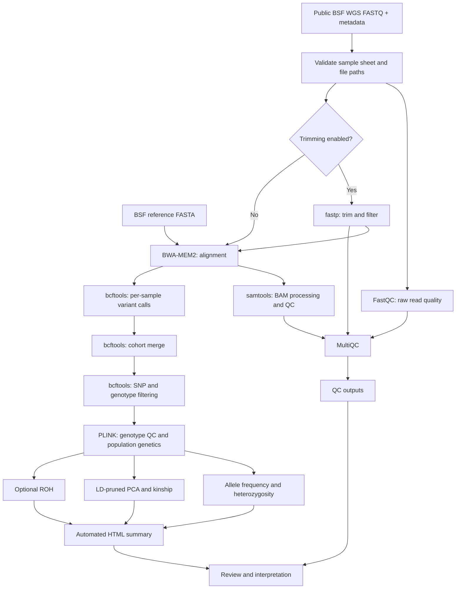

# BSF Genomic Diversity & Inbreeding Monitoring — Data and Workflow (v4)

> **Status:** Repository workflow specification, **not** a validated biological analysis. The sample sheet contains a placeholder (`EXAMPLE01`), and the figures marked `SIMULATED` are mockups.

## 1. Project objective

Develop a reproducible **Nextflow DSL2** pipeline for *Hermetia illucens* (black soldier fly, BSF) genomic diversity, inbreeding and population structure monitoring. The internship work plan calls for input validation, raw read QC, alignment, variant calling/filtering, diversity and inbreeding metrics, population structure, and automated reporting.

## 2. Public data and reference

| Resource | Identifier / path | Purpose | Current status |
|---|---|---|---|
| Public BSF sequencing project | NCBI BioProject `PRJNA1256126` (FLYgene) | Candidate public WGS reads | Referenced in repository; runs not populated |
| BSF reference assembly | RefSeq `GCF_905115235.1` | Alignment and variant calling | Referenced in repository; download required |
| Input sample sheet | `assets/samplesheet.csv` | FASTQ paths and sample metadata | Example row only |
| Paired-end FASTQ | `data/<sample>_1.fastq.gz`, `data/<sample>_2.fastq.gz` | Raw sequencing reads | Not included in ZIP |

**Important:** The identifiers above are specified by the repository, not independently verified here. Before analysis, confirm accession availability, assembly compatibility and metadata using authoritative source records. Do not interpret example rows as biological observations.

### Input samplesheet schema

```csv
sample,fastq_1,fastq_2,population,country,source
EXAMPLE01,data/EXAMPLE01_1.fastq.gz,data/EXAMPLE01_2.fastq.gz,replace_me,replace_me,replace_me
```

| Column | Meaning |
|---|---|
| `sample` | Unique sample ID; letters, digits, underscore, hyphen and period |
| `fastq_1`, `fastq_2` | Paths to paired-end FASTQ files |
| `population` | Population or sampling group for stratified analysis |
| `country` | Country of origin, if supported by source metadata |
| `source` | Data provenance or source identifier |

**Implemented validation:** nonempty sample sheet, unique/valid sample IDs, and existence of both FASTQ files. The present `main.nf` does not fully validate population/country/source values.

## 3. Workflow architecture



**Scientific caution:** the current cohort merge of independently called variant-only BCFs is a development-stage approach and may misrepresent uncalled reference genotypes. A production pipeline needs a validated all-sites/joint-genotyping strategy.

## 4. Modules, inputs and outputs

| Stage | Current module | Input | Expected output / role |
|---|---|---|---|
| 1. Input checks | `main.nf`, `bin/validate_samplesheet.py` | CSV, FASTQ paths | Validated sample metadata and files |
| 2. Raw read QC | `modules/fastqc.nf` | FASTQ | FastQC reports |
| 3. Trimming | `modules/fastp.nf` | Paired FASTQ | Clean FASTQ and fastp reports |
| 4. Alignment | `modules/bwa_mem2.nf` | Clean FASTQ, reference | Aligned BAM with read groups |
| 5. BAM QC | `modules/bam_qc.nf` | BAM | Alignment statistics |
| 6. Variant calling | `modules/bcftools_call.nf` | BAM, reference | Per-sample BCF and index |
| 7. Cohort assembly | `modules/joint_merge.nf` | Per-sample BCF | Merged cohort variant data |
| 8. Filtering | `modules/filter_cohort.nf` | Cohort variants | Filtered VCF and index |
| 9. Population genetics | `modules/plink_popgen.nf` | Filtered VCF | Genotype QC and genetic metrics |
| 10. QC aggregation | `modules/multiqc.nf` | Tool QC reports | MultiQC report |
| 11. Reporting | `modules/report.nf`, `bin/make_report.py` | Population-genetics outputs | Basic HTML summary |

### Analysis measures

| Measure | Biological question | Status / interpretation |
|---|---|---|
| Allele frequencies | How common are alternative alleles? | PLINK-based summary |
| Observed heterozygosity | How much within-individual variation exists? | PLINK-based summary; account for QC and coverage |
| Expected heterozygosity | How diverse is the sampled population? | Requires appropriate population-level aggregation |
| Inbreeding coefficient `F_IS` | Is there heterozygote deficit within populations? | **Not yet implemented** with a defined estimator |
| Relatedness / kinship | Which samples may be closely related? | KING/PLINK workflow; needs validation |
| PCA | Are genetic differences associated with sample groups? | LD-pruned PCA workflow; not yet shown on real data |
| Runs of homozygosity (ROH) | Are long homozygous tracts detectable? | Optional; thresholds must be calibrated |

## 5. Key parameters in `main.nf`

| Parameter | Default | Meaning |
|---|---:|---|
| `--maf` | `0.05` | Minimum minor allele frequency |
| `--geno` | `0.10` | Maximum variant missingness fraction |
| `--mind` | `0.10` | Maximum sample missingness fraction |
| `--min_qual` | `30` | Minimum variant quality |
| `--min_dp` | `5` | Minimum genotype depth |
| `--trim` | `true` | Enable fastp |
| `--roh` | `false` | Enable optional ROH analysis |

These are initial development settings, not validated thresholds for BSF populations.

## 6. Run instructions

```bash
conda env create -f envs/environment.yml
conda activate bsf-popgen
./bin/download_reference.sh

# Replace placeholder run IDs with verified public accessions.
./bin/download_sra_subset.sh SRR_ACCESSION_1 SRR_ACCESSION_2

# Populate assets/samplesheet.csv with the actual sample IDs, paths and metadata.
nextflow run main.nf \
  --input assets/samplesheet.csv \
  --reference reference/reference.fna \
  --outdir results \
  -profile conda
```

**Execution status:** commands are documented in the repository but an end-to-end run on real BSF data has not been verified. Check the profile and tool dependencies in the target environment before running.

## 7. Report and visualization plan

The v4 code provides a **basic HTML summary**. The repository also contains `report/BSF_report.qmd` as a Quarto report template. A complete validated report should include:

1. **Dataset inventory:** accession, sample, population, read count and provenance.
2. **Sequencing and alignment QC:** quality distributions, trimming, mapping rate and depth.
3. **Variant QC:** raw vs filtered variant counts, missingness, MAF and depth distributions.
4. **Diversity:** observed/expected heterozygosity and allele-frequency summaries by population.
5. **Inbreeding:** explicitly defined `F_IS` estimator, kinship summaries and optional ROH.
6. **Population structure:** PCA colored by validated sample metadata.
7. **Reproducibility:** software versions, parameters, reference build, sample exclusions and limitations.

**Existing images:** `figures/01_pipeline_architecture.png` is an architecture illustration. `figures/02_pca_mockup_SIMULATED.png` through `05_kinship_mockup_SIMULATED.png` are **simulated designs, not actual BSF findings**.

## 8. Twelve-week implementation roadmap

| Weeks | Goal | Expected evidence |
|---|---|---|
| 1–2 | Architecture, public data, sample sheet and QC | Dataset inventory, validated input, first QC |
| 3–4 | Alignment, calling and filtered genotypes | BAM QC, raw calls, filtered VCF/PLINK |
| 5–6 | Diversity and inbreeding | Heterozygosity, allele frequencies, `F_IS` plan, kinship, ROH feasibility |
| 7–8 | Population structure and stabilization | PCA, metadata grouping, reproducibility fixes |
| 9–10 | Reporting and full public test | Automated report, end-to-end validation and issue log |
| 11–12 | Documentation and handover | README, limitations, example outputs and presentation |

## 9. Validation checklist

- [ ] Verify real public sequencing runs and sample metadata.
- [ ] Download and verify a compatible reference assembly.
- [ ] Replace the placeholder sample sheet.
- [ ] Run a small reproducible end-to-end test.
- [ ] Replace/validate cohort genotyping strategy.
- [ ] Validate filtering sensitivity and sample exclusions.
- [ ] Implement and document population-specific `F_IS`.
- [ ] Calibrate ROH and relatedness settings.
- [ ] Generate **real-data** QC, PCA and diversity plots.
- [ ] Integrate the final Quarto report and record software provenance.

## 10. Repository pointers

- Pipeline entry point: `main.nf`
- Module implementations: `modules/`
- Input example: `assets/samplesheet.csv`
- Reference and SRA helpers: `bin/download_reference.sh`, `bin/download_sra_subset.sh`
- Reporting: `bin/make_report.py`, `report/BSF_report.qmd`
- Known caveats: `docs/V4_NOTES.md`, `docs/limitations.md`
- Weekly work logs: `docs/weeks/`
