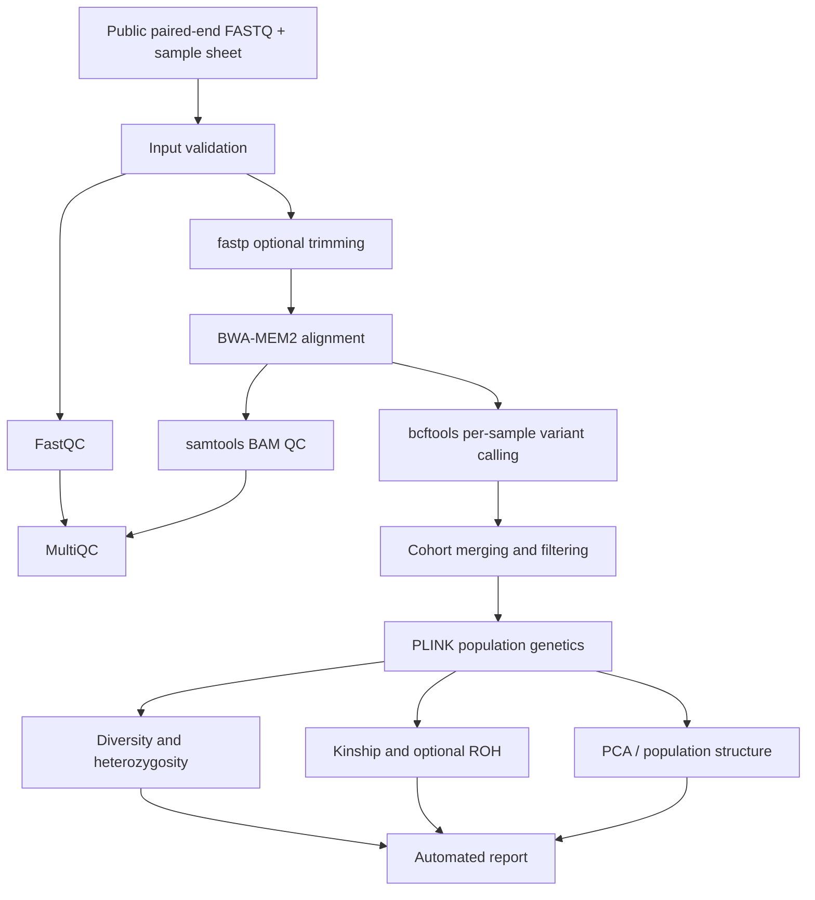

# BSF Genomic Diversity Pipeline — GitHub repository guide

## Overview

A development-stage Nextflow DSL2 workflow for Black Soldier Fly (BSF) genomic diversity and inbreeding monitoring, following the 12-week internship work plan. **Not yet validated end-to-end on public sequencing data.**

## Architecture



## Files and folders

```text
main.nf                     Nextflow entry point
nextflow.config             Execution profiles
assets/samplesheet.csv      Sample sheet template
bin/                        Download, validation and reporting scripts
modules/                    Nextflow DSL2 modules
envs/environment.yml        Conda environment specification
report/BSF_report.qmd       Quarto report template
figures/                    Architecture image and simulated example plots
conf/test.config            Test configuration
tests/README.md             Testing notes
docs/                       Usage, workflow and weekly notes
```

## Run locally

Requirements: Java, Nextflow, Conda/Mamba, sufficient RAM and disk space for the selected reads.

```bash
unzip bsf-genomic-diversity-pipeline-v4.zip
cd bsf-genomic-diversity-pipeline-v4
conda env create -f envs/environment.yml
conda activate bsf-popgen  # Check environment name in YAML
# Populate assets/samplesheet.csv with real FASTQ paths
# Supply a compatible BSF reference at reference/reference.fna
nextflow run main.nf -profile conda \
  --input assets/samplesheet.csv \
  --reference reference/reference.fna \
  --outdir results -resume
```

Do not use the example sample sheet as real data. Consult [CLI Run Guide](CLI_RUN_GUIDE.md) for additional commands.

## GitHub publishing

```bash
git init
git add .
git commit -m "docs: publish BSF Nextflow v4 repository"
git branch -M main
git remote add origin https://github.com/YOUR_USERNAME/bsf-genomic-diversity-pipeline.git
git push -u origin main
```

Create the empty remote repository before pushing. **Do not commit raw FASTQ, BAM, VCF, reference downloads, results, credentials, or `.nextflow` caches.** Review `git status` and `.gitignore` before `git add .`.

## Documentation

- [Documentation index](INDEX.md)
- [CLI guide](CLI_RUN_GUIDE.md)
- [Data and workflow](DATA_AND_WORKFLOW.md)
- [Output schema](output_schema.md)
- [Limitations](limitations.md)
- [Week 1](weeks/week01.md) through [Week 12](weeks/week12.md)

## Validation and limitations

The code includes modules for preprocessing, alignment, variant calling, filtering and downstream population genetics. The project still needs verified sample accessions, reproducible reference selection, successful end-to-end tests, and scientific validation of joint genotyping, FIS, relatedness and ROH before interpreting results.
